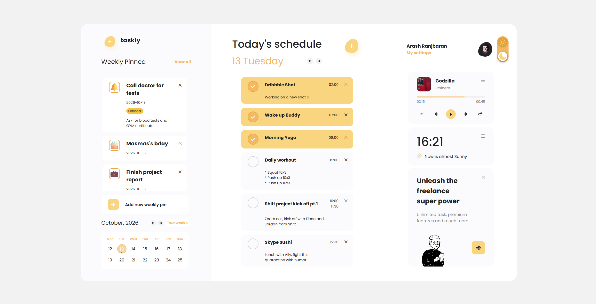

# Taskly — Task Manager

Taskly — минималистичный таск-менеджер с календарём, тёмной темой и закреплёнными задачами.



## Демо

Живая версия: https://lightgreen-96.github.io/Task-manager/

## Функционал

- Управление задачами на день (создание, редактирование, удаление, отметка выполненными).
- Закреплённые задачи на неделю (Weekly Pinned) с выбором эмодзи.
- Календарь с переключением месяцев, выбором дня и индикаторами задач.
- Тёмная и светлая темы с автовыбором по времени суток.
- Модалка настроек с переключением вкладок.
- Часы реального времени.
- Сохранение всех данных в localStorage.

## Технологии

- HTML5
- CSS3 (Flexbox, Grid, CSS-переменные)
- JavaScript (ES6+, модульная структура)
- LocalStorage

## Структура проекта

```
Task-manager/
├── css/               # Стили, разбитые по модулям
├── js/                # JS-модули
├── images/            # Картинки и иконки
├── Promo/             # Страница промо
├── screenshots/       # Скриншоты для README
├── index.html         # Главная страница
└── README.md
```

## Как запустить локально

1. Склонируй репозиторий:
   ```
   git clone https://github.com/lightgreen-96/Task-manager.git
   ```

2. Открой папку проекта в VS Code.

3. Запусти Live Server (расширение VS Code) — или просто открой `index.html` в браузере.

## Планы на будущее

- [ ] Реальная погода через API (Open-Meteo)
- [ ] Формат времени 12/24 часа в настройках
- [ ] Адаптив для мобильных устройств
- [ ] Работающий плеер с аудио

## Автор

**Андрей Годлевский**
- GitHub: [@lightgreen-96](https://github.com/lightgreen-96)